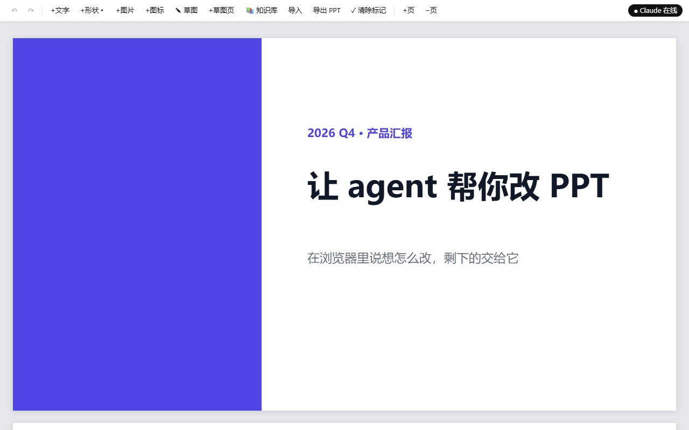
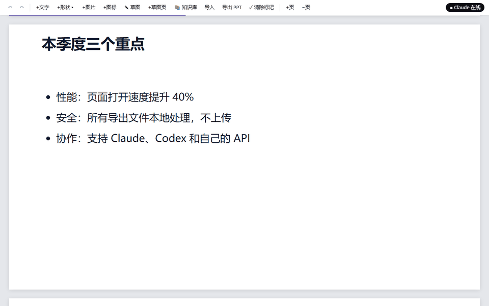
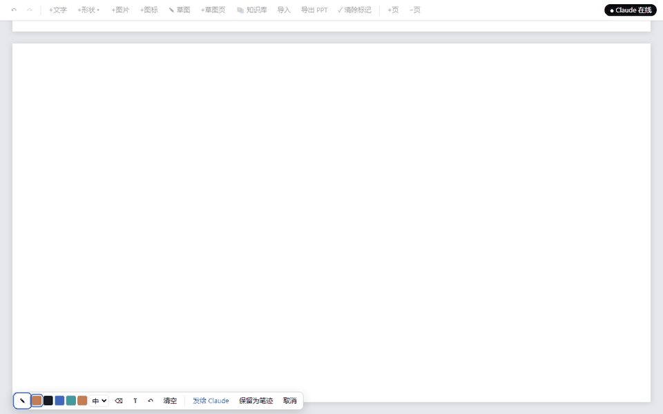
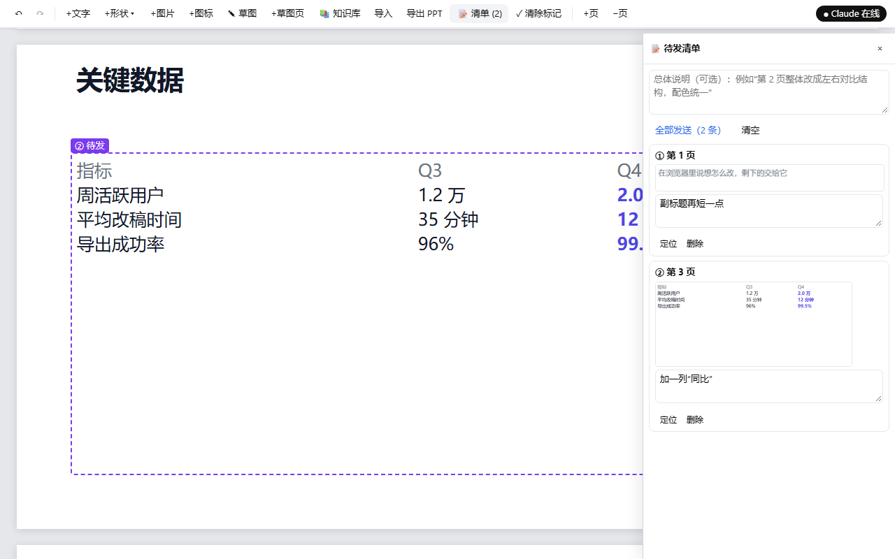
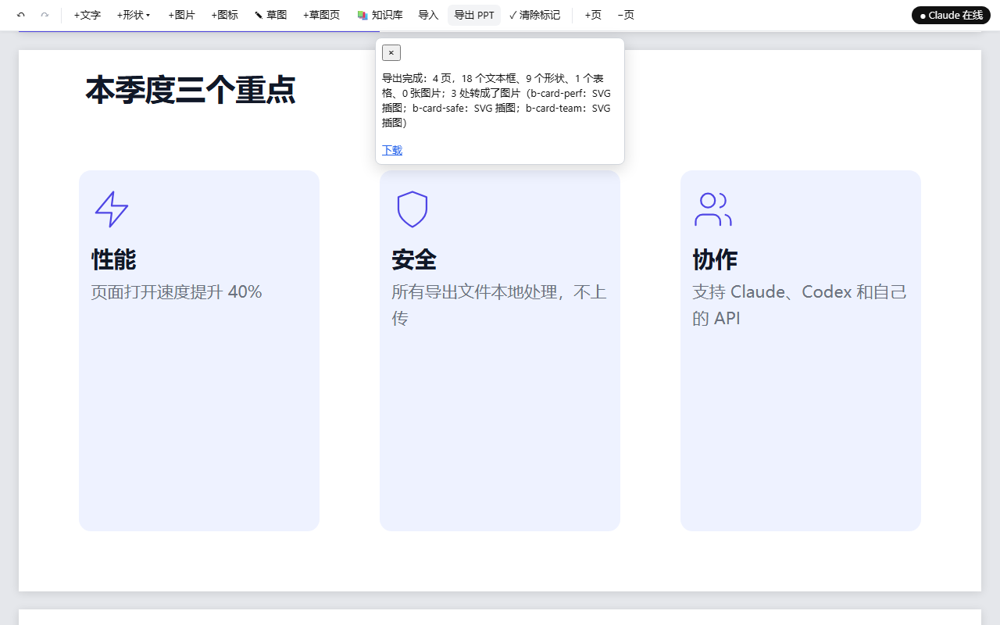

# ppt-maker

在浏览器里点一点、写一句"想怎么改"，由 agent 帮你改幻灯片，最后导出成可以在 PowerPoint 里继续编辑的 `.pptx`。



## 看它怎么用

**点一块，说想怎么改。** agent 收到后改好这一块，并在旁边回执说明改了什么。框的颜色表示状态：橙色排队中、蓝色处理中、绿色已完成。



**画个草图也行。** 线框表示布局，箭头表示流程，再加几句标注。agent 会把它做成正式的页面，而不是把手绘线条照搬上去。



**攒一张清单一起发。** 改动多的时候先逐条记下（紫色虚线框），写一句总体说明后一次发出，agent 会通盘考虑再改。



**导出可编辑的 PPTX。** 文字、形状、表格在 PowerPoint 里都能继续编辑；转不了的部分会转成图片，并在报告里列出来。



## 功能

- **在浏览器里操作**：框选一块写意图、只改一句话、画草图、攒一张清单一起发、直接改字和拖动，并且能撤销和重做。
- **agent 改文件**：每个操作以事件形式发给 agent，由它修改 `decks/<名字>/deck.html`，改完在页面上回执。
- **三种 agent**：Claude Code、Codex，或者你自己的 API（LLM 或 agent）。
- **其他功能**：知识库（PDF、图片、网页、旧稿子）、导入 `.pptx` / HTML、导出 `.pptx`。

这个项目只做"用 agent 方便地改 PPT"，不做演示模式。动画和切换效果目前不支持。

## 需要
- Python 3（核心功能只用标准库）
- Edge 或 Chrome
- 可选：
  - `pip install python-pptx`：导入和导出 `.pptx` 时需要；
  - LibreOffice：导入 `.pptx` 时用来对照原稿的样子。
- 以下三选一：[Claude Code](https://claude.com/claude-code)、[Codex CLI](https://github.com/openai/codex)、你自己的 API。

## 快速开始

**Claude Code**
```
python ppt/server.py --install-claude      # 只需一次：装好全局 /ppt 命令
```
在任意目录打开 Claude Code，输入 `/ppt 我的演讲`。

**Codex**
```
python ppt/server.py --install-codex       # 只需一次：装好 $ppt 技能，并打印要加进 ~/.codex/config.toml 的设置
```
改好 `config.toml` 后重开 Codex，输入 `$ppt 我的演讲`。

**自己的 API**
```powershell
$env:PPT_API_KEY = "你的 key"
python ppt/runner.py "decks/我的演讲" --backend llm --base-url https://api.deepseek.com/v1 --model deepseek-chat
python ppt/runner.py "decks/我的演讲" --backend agent --cmd "你的 agent 命令"
```
详见 [docs/api-runner.md](docs/api-runner.md)。

三种方式都会启动本地服务并打开浏览器。稿子放在当前目录的 `decks/<名字>/` 下，不存在时会从模板新建。同一份稿子一次只开一种。

## 文档
- [docs/guide.html](docs/guide.html)：使用指南（浏览器里怎么操作、框的颜色、常见问题）
- [docs/api-runner.md](docs/api-runner.md)：用自己的 API 驱动，以及怎么接入
- `prompts/ppt-common.md`：agent 处理事件的规则和 deck.html 格式规则（Claude、Codex、agent 后端共用）
- `prompts/ppt-llm.md`：LLM 后端的规则和返回格式
- `docs/superpowers/specs/`、`docs/superpowers/plans/`：各个子项目的设计和实现计划

## 目录
| 路径 | 内容 |
|---|---|
| `ppt/server.py` | 本地服务：页面、事件收发、撤销历史、知识库、导入导出；也是给 agent 用的命令行 |
| `ppt/runner.py` | 用自己的 API 代替 agent 会话 |
| `ppt/*.js`、`ppt/editor.css` | 浏览器里的编辑层 |
| `ppt/importer.py`、`ppt/exporter.py`、`ppt/kb.py` | 导入、导出 `.pptx`，知识库 |
| `ppt/template.html` | 新稿子的模板 |
| `.claude/commands/ppt.md`、`claude/commands/ppt.md` | Claude Code 的 `/ppt`（项目内用的 / 全局安装用的模板） |
| `codex/skills/ppt/SKILL.md` | Codex 的 `$ppt` 技能 |
| `tools/readme-media.mjs` | 录制 README 的截图和动图 |

## 测试
```
python ppt/test_server.py      # 服务端
python ppt/test_runner.py      # runner
node tests/e2e.mjs             # 浏览器端到端，需要 Node 22+ 和 Edge/Chrome，只用 decks/e2e-smoke
```
Windows 上中文输出可以先设 `PYTHONIOENCODING=utf-8`。

README 里的截图和动图由 `node tools/readme-media.mjs` 从真实编辑器录制（需要 Pillow），界面改了以后重跑一次即可更新。录制时 agent 一侧由脚本代替（直接写回执和改稿），所以不需要 API key，每次结果也一样。
